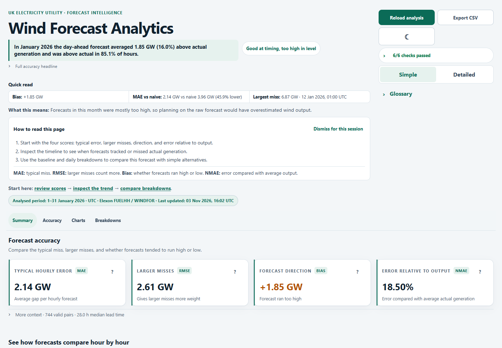
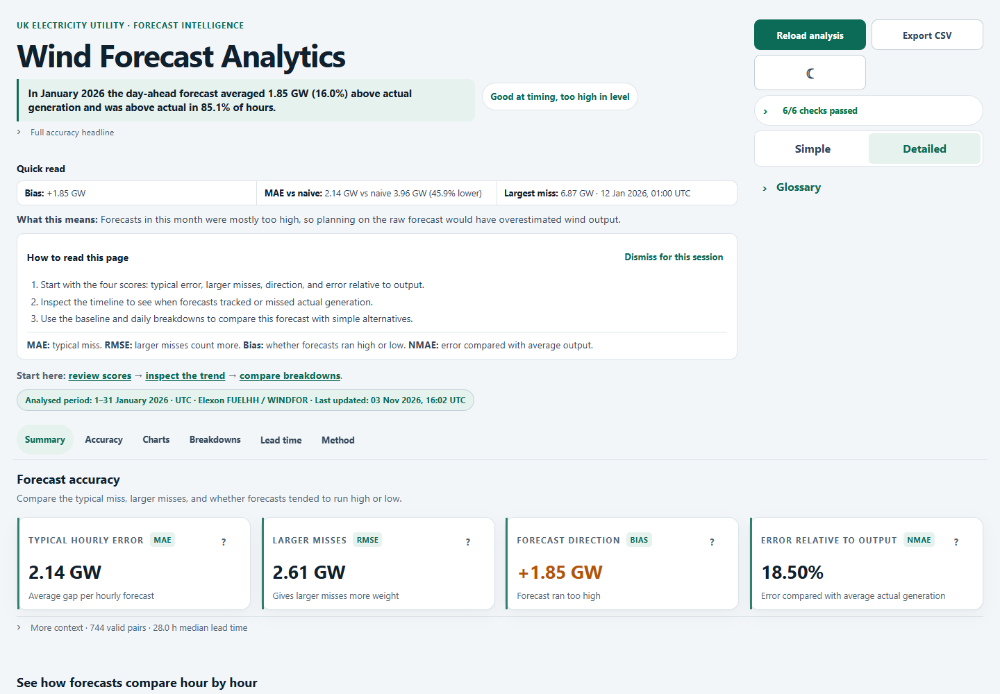
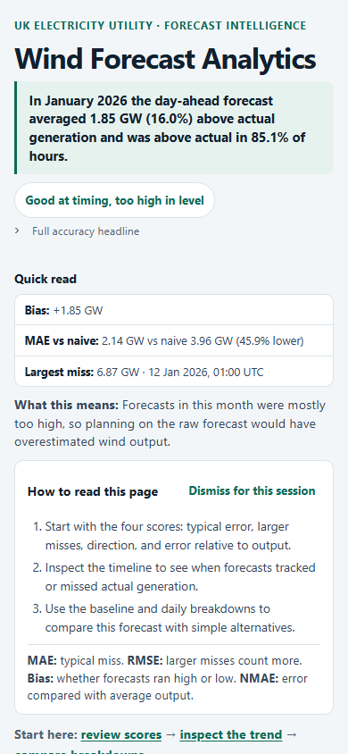

# Wind Forecast Analytics

A full-stack dashboard comparing Elexon national wind generation actuals (FUELHH, fuel type `WIND`) with WINDFOR forecasts for delivery hours in January 2026. It reports forecast accuracy, bias, lead-time patterns, a previous-day persistence baseline, and timestamp sensitivity. The dashboard reads generated analysis files through a FastAPI API; it does not make live Elexon requests.

### Dashboard screenshots







## Code layout

- `frontend/src/` contains the React dashboard, API client, charts, reusable components, and styles.
- `backend/app/` contains the FastAPI routes, response schemas, and analysis/data-loading services.
- `backend/scripts/` contains the Elexon data retrieval and January analysis scripts.
- `backend/tests/` contains backend tests.
- `backend/data/raw/` and `backend/data/processed/` contain generated input and analysis files; these are not committed.
- `docs/` contains dashboard documentation assets, including the screenshot above.
- `compose.yaml` defines the Docker Compose services; `.env.example` documents local configuration.

## How to run

### Docker Compose

Requirements: Docker Desktop with Compose. From the repository root:

```powershell
docker compose run --rm backend python scripts/fetch_january_data.py
docker compose run --rm backend python scripts/analyse_january_data.py
docker compose up --build
```

Open the dashboard at <http://localhost:8080>. The API is available at <http://localhost:8000>; health check: <http://localhost:8000/api/health>; interactive docs: <http://localhost:8000/docs>. Stop the services with `Ctrl+C`, or run `docker compose down` in another terminal.

The first two commands fetch and validate the official Elexon datasets, then generate the analysis artefacts. Generated data is ignored by Git and is stored under `backend/data/`.

### Run the backend and frontend separately

Requirements: Python 3.11+ and Node.js `^20.19.0` or `>=22.12.0` with npm. In PowerShell, use two terminals.

Backend terminal:

```powershell
cd backend
python -m venv .venv
.\.venv\Scripts\Activate.ps1
python -m pip install -r requirements.txt
python scripts/fetch_january_data.py
python scripts/analyse_january_data.py
python -m uvicorn app.main:app --reload --port 8000
```

Frontend terminal:

```powershell
cd frontend
npm ci
Copy-Item .env.example .env
npm run dev
```

Open <http://localhost:5173>. The default `VITE_API_BASE_URL` is `http://localhost:8000`. The backend CORS setting must allow the frontend origin; `.env.example` includes the Vite development origin.

## Data files used

All generated data is local under `backend/data/` and is not committed.

| File | Purpose |
| --- | --- |
| `raw/actuals_january_2026.json` | Unmodified FUELHH API response, including the prior-day actuals needed by the baseline |
| `raw/forecasts_january_2026.json` | Unmodified WINDFOR publication vintages |
| `processed/actuals_january_2026.json` | Validated half-hour actuals from 2025-12-31 through January 2026 (1,536 records) |
| `processed/forecasts_january_2026.json` | Validated forecast vintages for January targets (18,080 versions across 744 targets) |
| `processed/validation_report.json` | Retrieval, validation, duplicate, resolution, and rejected-row counts |
| `processed/hourly_actuals_january_2026.json` | Hourly actuals, each averaged from both required half-hour readings |
| `processed/selected_forecasts_january_2026.json` | One eligible forecast vintage selected per target, with publish time and lead time |
| `processed/aligned_analysis_january_2026.json` | Actual and selected forecast pairs used for all analysis calculations |
| `processed/analysis_report_january_2026.json` | Metrics, additional calculations, assumptions, and audit details served by the API |

The extra December 31 actuals provide the same UTC hour on the previous day for the naive baseline. The scoring window remains January 1–31, 2026 UTC.

## Method

- **Forecast selection:** for delivery day `D`, select the latest forecast with `publishTime` strictly before 09:20 Europe/London on `D-1`. A publication exactly at 09:20 is excluded. This cutoff is held fixed as a provisional benchmark assumption; it is not prescribed by the challenge.
- **Period labelling:** treat `startTime` as the start of the interval. FUELHH settlement periods run from 00:00 (period 1) through 23:30 (period 48); each half-hour actual is published 30 minutes after its start. A complete hourly actual is the mean of the two half-hours in that hour. Both are required; partial hours are not averaged. WINDFOR is hourly and its `startTime` is aligned with the corresponding actual hour. No timestamps are shifted in the primary analysis.
- **Alignment:** compare each hourly actual with the forecast selected for the same target hour. The backend calculates all values from these aligned pairs. Existing MAE, RMSE, bias, and nMAE definitions are unchanged.
- **Additional analysis:** absolute-error percentiles use linear interpolation. The largest miss is the aligned hour with the greatest absolute error. The persistence baseline predicts each hour using the actual from the same UTC hour on the previous day. Lead buckets are six hours wide up to 40h; hourly groups use UTC delivery hour. Bias-removed RMSE subtracts the mean error before calculating RMSE. The bias share of squared error is `bias² / RMSE²`.
- **Timestamp sensitivity:** −1h compares the actual target with the previous forecast hour; +1h compares it with the following forecast hour. Edge targets without a shifted forecast are omitted from that row. The 0h row is the primary period-labelling convention.

## Known limitations

- The challenge does not identify an exchange or internal decision deadline. The 09:20 Europe/London cutoff is a provisional day-ahead benchmark and needs confirmation before operational use.
- The datasets may represent different wind-generation populations. In this January snapshot the mean forecast generation is materially above mean actual generation. Metrics are shown raw; no capacity or coverage adjustment is applied.
- WINDFOR's period-start interpretation is described indirectly in the challenge. The sensitivity table makes the impact of a one-hour shift visible.
- MAPE is omitted because percentage errors become unstable when actual wind generation is low. All displayed results are forecast-accuracy analysis only. **Not a financial estimate.** The challenge provides no cost, price, or volume data to support a savings, procurement, or trading conclusion.
- The dashboard serves generated files. “Reload analysis” reloads the local API results; it does not fetch new Elexon data.

## AI tools

OpenAI Codex was used as an AI coding assistant during implementation and the dashboard UI improvement work.

## Deployment

The public deployment URL will be added here after deployment and access verification.

## Tests and build

Backend tests (run from `backend/`):

```powershell
python -m pytest
```

The complete suite passes with the generated January data present. On a fresh checkout, first run the fetch and analysis commands above; tests that read generated artefacts need those files.

Frontend production build (run from `frontend/`):

```powershell
npm ci
npm run build
```

The project has no separate frontend test script. The charts include loading, empty, and error states plus keyboard-accessible data tables; the data-quality checks use a native expandable disclosure.
