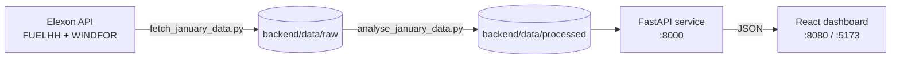

# Wind Forecast Analytics


A full-stack dashboard that answers one question: **how good were the day-ahead wind forecasts in January 2026?**

It compares Elexon national wind generation actuals (FUELHH, fuel type `WIND`) with WINDFOR forecasts and reports accuracy, bias, lead-time patterns, a previous-day persistence baseline, and timestamp sensitivity. The dashboard reads pre-generated analysis files through a FastAPI API and makes no live Elexon requests.

The dashboard supports Simple and Detailed views on desktop and mobile.

## Table of contents

- [Key findings](#key-findings)
- [Features](#features)
- [Architecture](#architecture)
- [Quick start](#quick-start)
- [Run without Docker](#run-without-docker)
- [Method](#method)
- [Data files](#data-files)
- [Known limitations](#known-limitations)
- [Tests and build](#tests-and-build)
- [Project structure](#project-structure)
- [AI tools](#ai-tools)
- [Deployment](#deployment)

## Key findings

> Fill these in from `analysis_report_january_2026.json` (or the dashboard) before publishing.

| Metric | Forecast (WINDFOR) | Persistence baseline |
| --- | --- | --- |
| MAE (MW) | _TODO_ | _TODO_ |
| RMSE (MW) | _TODO_ | _TODO_ |
| Bias (MW) | _TODO_ | _TODO_ |
| nMAE | _TODO_ | _TODO_ |

- **Versus baseline:** _TODO: does the forecast beat "same hour yesterday"?_
- **Bias:** _TODO: mean forecast is materially above mean actual; state the size and what share of squared error it explains._
- **Lead time:** _TODO: how does error change across the 6-hour lead buckets?_
- **Largest miss:** _TODO: date, hour, and error size._

## Features

- Forecast accuracy metrics: MAE, RMSE, bias, nMAE, and absolute-error percentiles
- Bias-removed RMSE and bias share of squared error (`bias² / RMSE²`)
- Persistence baseline (same UTC hour on the previous day)
- Error breakdown by lead-time bucket and by UTC delivery hour
- Timestamp sensitivity table (−1h / 0h / +1h)
- Data-quality report covering duplicates, rejected rows, and validation counts
- Accessible charts with loading, empty, and error states, plus keyboard-accessible data tables
- Responsive layout (desktop and mobile)

## Architecture



Data retrieval and analysis run as offline scripts. The API only serves the generated files, so the dashboard is fast and reproducible.

## Quick start

**Requirements:** Docker Desktop with Compose. Run from the repository root (works in bash, zsh, and PowerShell):

```bash
# 1. Fetch and validate the official Elexon datasets
docker compose run --rm backend python scripts/fetch_january_data.py

# 2. Generate the analysis artefacts
docker compose run --rm backend python scripts/analyse_january_data.py

# 3. Start the API and dashboard
docker compose up --build
```

| Service | URL |
| --- | --- |
| Dashboard | <http://localhost:8080> |
| API | <http://localhost:8000> |
| Health check | <http://localhost:8000/api/health> |
| Interactive API docs | <http://localhost:8000/docs> |

Stop with `Ctrl+C`, or run `docker compose down` from another terminal. Raw API downloads and intermediate generated data are ignored by Git under `backend/data/`; the two processed files needed at runtime are tracked for the hosted API.

## Run without Docker

**Requirements:** Python 3.11+ and Node.js `^20.19.0` or `>=22.12.0` with npm. Use two terminals.

**Backend**

<details open>
<summary>macOS / Linux</summary>

```bash
cd backend
python -m venv .venv
source .venv/bin/activate
python -m pip install -r requirements.txt
python scripts/fetch_january_data.py
python scripts/analyse_january_data.py
python -m uvicorn app.main:app --reload --port 8000
```

</details>

<details>
<summary>Windows (PowerShell)</summary>

```powershell
cd backend
python -m venv .venv
.\.venv\Scripts\Activate.ps1
python -m pip install -r requirements.txt
python scripts/fetch_january_data.py
python scripts/analyse_january_data.py
python -m uvicorn app.main:app --reload --port 8000
```

</details>

**Frontend**

```bash
cd frontend
npm ci
cp .env.example .env      # PowerShell: Copy-Item .env.example .env
npm run dev
```

Open <http://localhost:5173>. The default `VITE_API_BASE_URL` is `http://localhost:8000`. The backend CORS setting must allow the frontend origin; `.env.example` includes the Vite development origin.

## Method

- **Forecast selection:** for delivery day `D`, select the latest forecast with `publishTime` strictly before 09:20 Europe/London on `D-1`. A publication exactly at 09:20 is excluded. This cutoff is a fixed, provisional benchmark assumption, not something the challenge prescribes.
- **Period labelling:** `startTime` is treated as the start of the interval. FUELHH settlement periods run from 00:00 (period 1) to 23:30 (period 48). A complete hourly actual is the mean of both half-hours in that hour; partial hours are not averaged. WINDFOR is hourly and its `startTime` aligns with the matching actual hour. No timestamps are shifted in the primary analysis.
- **Alignment:** each hourly actual is compared with the forecast selected for the same target hour. All values are calculated by the backend from these aligned pairs.
- **Additional analysis:** percentiles use linear interpolation. The largest miss is the aligned hour with the greatest absolute error. The persistence baseline predicts each hour from the actual at the same UTC hour the previous day. Lead buckets are six hours wide up to 40h; hourly groups use UTC delivery hour.
- **Timestamp sensitivity:** −1h compares the actual with the previous forecast hour and +1h with the following one. Edge targets without a shifted forecast are omitted from that row. The 0h row is the primary convention.
- **Scoring window:** January 1–31, 2026 UTC. The extra December 31 actuals exist only to supply the baseline for January 1.

## Data files

Raw API downloads and generated intermediate files are local and ignored. The aligned analysis and report are tracked so the hosted API can serve the same precomputed January analysis without recalculating metrics at request time.

| File | Purpose |
| --- | --- |
| `raw/actuals_january_2026.json` | Unmodified FUELHH response, including prior-day actuals for the baseline |
| `raw/forecasts_january_2026.json` | Unmodified WINDFOR publication vintages |
| `processed/actuals_january_2026.json` | Validated half-hour actuals, 2025-12-31 to January 2026 (1,536 records) |
| `processed/forecasts_january_2026.json` | Validated forecast vintages (18,080 versions across 744 targets) |
| `processed/validation_report.json` | Retrieval, validation, duplicate, resolution, and rejected-row counts |
| `processed/hourly_actuals_january_2026.json` | Hourly actuals, each averaged from two half-hour readings |
| `processed/selected_forecasts_january_2026.json` | One eligible vintage per target, with publish time and lead time |
| `processed/aligned_analysis_january_2026.json` | Actual and forecast pairs used for all calculations |
| `processed/analysis_report_january_2026.json` | Metrics, extra calculations, assumptions, and audit details served by the API |

## Known limitations

- **Cutoff is an assumption.** The challenge gives no exchange or internal decision deadline. The 09:20 Europe/London cutoff needs confirmation before operational use.
- **Populations may differ.** The two datasets may cover different wind-generation populations; in this snapshot mean forecast generation is materially above mean actual. Metrics are raw, with no capacity or coverage adjustment.
- **Period-start interpretation.** WINDFOR's convention is described only indirectly, so the sensitivity table shows the effect of a one-hour shift.
- **No MAPE.** Percentage errors are unstable when actual wind output is low.
- **Not a financial estimate.** There is no cost, price, or volume data, so nothing here supports a savings, procurement, or trading conclusion.
- **Static data.** "Reload analysis" re-reads the local API results; it does not fetch new Elexon data.

## Tests and build

Backend tests, from `backend/`:

```bash
python -m pytest
```

The full suite passes with the generated January data present. On a fresh checkout, run the fetch and analysis commands first, since some tests read the generated artefacts.

Frontend production build, from `frontend/`:

```bash
npm ci
npm run build
```

There is no separate frontend test script.

## Project structure

```text
.
├── backend/
│   ├── app/          # FastAPI routes, response schemas, analysis and data-loading services
│   ├── scripts/      # Elexon data retrieval and January analysis scripts
│   ├── tests/        # Backend tests
│   └── data/         # Generated raw/ and processed/ files; only runtime report + aligned pairs tracked
├── frontend/
│   └── src/          # React dashboard, API client, charts, components, styles
├── index.py          # Vercel FastAPI entry point
├── compose.yaml      # Docker Compose services
├── vercel.json       # Vercel build configuration
└── .env.example      # Local configuration reference
```

## Deployment

Production dashboard: <https://wind-forecast-analytics-dashboard.vercel.app>

The Vercel deployment serves the React dashboard and the existing FastAPI
endpoints from one origin. It uses the tracked January analysis artefacts; it
does not retrieve live Elexon data or recalculate metrics during requests.
